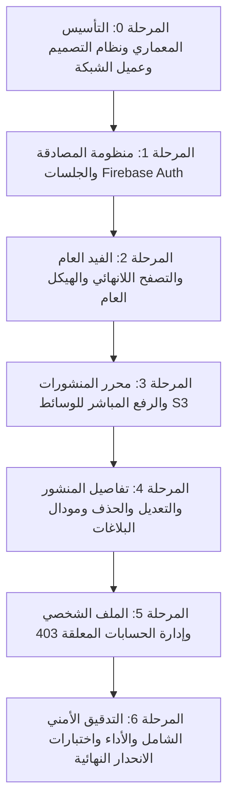

# المخطط التنفيذي الشامل لتطوير الواجهة الأمامية — منصة عُقاب (Ummah Platform V1)
## Comprehensive Engineering Execution & Integration Plan (Staff Architect Level)

---

### 1. الرؤية الهندسية والضوابط الصارمة (Core Principles)

1. **المطابقة البصرية التامة (100% Pixel-Perfect Design Parity):**
   * الحفاظ الصارم على الهوية البصرية الموجودة في `project/`:
     * نظام الألوان: الذهبي الأساسي (`--accent: #c9a559`)، الأسود الليلي الفخم (`--night: #0a0a0a`)، ورق البطاقات (`--paper: #ffffff`)، ودرجات الرمادي والحدود الدقيقة.
     * الطباعة والخطوط: خط `IBM Plex Sans Arabic` الأساسي مع `Playfair Display` للأرقام والعناوين اللاتينية.
     * حركة الواجهات والانسيابية: أنميشن `soft-arrive`، `modal-rise`، وتأثيرات التمرير والـ Hover.
2. **سقف الـ 250 سطراً (Hard Limit 250 LOC):**
   * يُمنع منعاً باتاً أن يتجاوز أي ملف في المشروع 250 سطراً من الكود البرمجي. أي مكون أو خطاف يكبر حجمه يتم تفكيكه فورياً إلى Sub-components أو Custom Hooks.
3. **قواعد الفصل الذري (Rule of 2+ & Rule of 1):**
   * أي عنصر يتكرر مرتين فأكثر يعزل في `src/components/ui/`.
   * أي مكون مستقل المسؤولية ومعقد المنطق يعزل في موديول خاص به داخل مجلد الميزة (Feature Module).
4. **حدود النطاق الصارمة لـ V1 (Zero Over-Engineering):**
   * لا إعجابات، لا تعليقات، لا متابعة حسابات، لا محادثات خاصة، لا شاشة إشعارات، ولا لوحة تحكم ويب. التركيز ينصب بنسبة 100% على جوهر المنظومة.
5. **الأمان ومنع التسريب (Enterprise Security):**
   * عدم تخزين أي مفاتيح سرية في الكلاينت، عزل الـ Tokens داخل Interceptors آمنة، تعقيم كافة المدخلات من ثغرات XSS، والرفع المباشر السحابي عبر الروابط الموقعة (Presigned PUT URLs).

---

### 2. مصفوفة المراحل التنفيذية (Milestone Execution Roadmap)

---

### المرحلة 0: التأسيس المعماري، نظام التصميم، والنواة الأساسية للشبكة
> **الهدف:** بناء الأساس الهيكلي للمشروع، نقل الـ Design System كاملاً من `project` دون أي نقص بصري، وبناء مكونات الـ UI الذرية (Atoms) مع عميل الـ API والـ Types.

#### مخرجات العمل (Deliverables):
1. **هيكلة المشروع وإعدادات الحزم (Project Setup):**
   * تجهيز البيئة باستخدام Vite + React + TypeScript + Tailwind CSS.
   * ضبط مسارات الاستيراد المختصرة `@/*` في `tsconfig.json`.
   * تثبيت المكتبات الأساسية المعتمدة فقط: `axios`، `@tanstack/react-query`، `lucide-react`، و `firebase`.
2. **نظام التصميم والأصول البصرية (Design Tokens & Assets):**
   * نقل كامل المتغيرات والأنماط من `project/src/index.css` إلى `src/index.css`.
   * ضبط الخطوط العربية `IBM Plex Sans Arabic` والإنجليزية `Playfair Display`.
   * نقل شعار المنصة الرسمي والأيقونات إلى `public/assets/`.
3. **مكونات الواجهة الأساسية (Reusable UI Atoms - أقل من 100 سطر لكل مكون):**
   * `Button.tsx`: أزرار متغيرة (Primary الذهبي، Outline، Danger) مع دعم حالة التحميل والتعطيل.
   * `Input.tsx` و `Textarea.tsx`: حقول إدخال مطابقة لتصميم `project` مع حالات الخطأ والتركيز.
   * `Avatar.tsx`: صورة المستخدم الدائرية مع Fallback أنيق للحرف الأول.
   * `Modal.tsx`: النافذة المنبثقة ذات الخلفية المعتمة والبلور (`backdrop-filter`) وأنيميشن الصعود.
   * `Toast.tsx`: نظام التنبيهات المنبثقة السفلية للرسائل والأخطاء.
   * `Skeleton.tsx`: وميض التحميل (Shimmer) للبطاقات والنصوص مطابق لـ `project`.
   * `Badge.tsx`: شارات الحالات (نشط، مخفي، معلق).
4. **نواة الشبكة والـ API (API Core Layer):**
   * `src/api/client.ts`: إعداد Axios الأساسي مع Base URL والمهلة الزمنية.
   * `src/api/types/api.types.ts`: الأنواع المستخرجة بدقة من `openapi-spec.json`.
   * `src/api/interceptors/error.interceptor.ts`: معالج موحد لأخطاء السيرفر.

#### شروط القبول (Acceptance Criteria):
* [ ] التطبيق يبني ويعمل بدون أي تحذيرات أو أخطاء TypeScript (`npm run typecheck` و `npm run build` بنجاح).
* [ ] كافة مكونات الـ UI تطابق تصميم `project` بنسبة 100% بصرياً.
* [ ] لا يوجد أي ملف يتجاوز 150 سطراً في هذه المرحلة.
* [ ] عميل Axios مهيأ ومعزول تماماً ومستعد للربط بالـ Interceptors.

#### خطة الاختبار والتحقق (Tests & Verification):
* **اختبار بناء المشروع والتصنيف:** تشغيل `npm run typecheck` و `npm run lint`.
* **اختبار المكونات البصرية:** فحص رندر المكونات في صفحة اختبار معزولة (زر، مودال، حقول، أفتار) والتأكد من مطابقة الألوان والأنميشن.
* **توثيق التحقق:** تسجيل نتيجة البناء وتأكيد توافق الألوان والخطوط.

---

### المرحلة 1: منظومة المصادقة وإدارة الجلسات (Auth Pipeline & Session)
> **الهدف:** بناء تدفق الدخول عبر Firebase (الهاتف/البريد) والربط مع `GET /auth/me` مع معالجة الـ Token التلقائية وإدارة حالة الزائر vs المستخدم.

#### مخرجات العمل (Deliverables):
1. **تهيئة Firebase Client (`src/lib/firebase.ts`):**
   * إعداد كائن Firebase App و Firebase Auth باستخدام المتغيرات البيئية `VITE_FIREBASE_*`.
   * دالة `getFirebaseAuthToken()` مع معالجة التحديث التلقائي للتوكن (Refresh Token).
2. **حقن التوكن التلقائي (`src/api/interceptors/auth.interceptor.ts`):**
   * اعتراض كل طلب HTTP وإرفاق ترويسة `Authorization: Bearer <token>` إذا كان المستخدم مسجلاً.
   * تمرير الطلب كـ Guest إذا لم يتوفر توكن للمسارات العامة (Token Immunity).
3. **سياق المصادقة (`src/context/AuthContext.tsx`):**
   * إدارة حالة المستخدم الحالي (`user`, `token`, `isAuthenticated`, `isLoading`).
   * الاستعلام عن بيانات المستخدم من السيرفر فور تسجيل الدخول عبر `GET /auth/me`.
4. **واجهة تسجيل الدخول (`src/features/auth/`):**
   * تصميم شاشة / مودال تسجيل الدخول مطابقاً لـ `project` (إدخال الهاتف/البريد، إرسال الرمز، التحقق).
   * إظهار أزرار الحالة في الـ Topbar (تسجيل الدخول للزوار، وشريحة المستخدم `user-chip` مع الأفتار للمسجلين).

#### شروط القبول (Acceptance Criteria):
* [ ] نجاح تسجيل الدخول بالهاتف أو البريد عبر Firebase واستخراج الـ ID Token.
* [ ] استدعاء `GET /auth/me` بنجاح وتخزين بيانات المستخدم في الكلاينت دون تسريب للـ Tokens في السجلات.
* [ ] الـ Topbar يعكس حالة المستخدم الصحيحة ديناميكياً (زائر vs مسجل).
* [ ] في حالة مسارات الزوار، تمر الطلبات بدون أخطاء مصادقة.

#### خطة الاختبار والتحقق (Tests & Verification):
* **اختبار المرحلة 1:** تجربة تسجيل الدخول بحساب تجريبي والتأكد من وصول ترويسة `Authorization` في الـ Network Tab.
* **فحص الانحدار التراكمي (Regression for Phase 0):** التأكد من أن جميع مكونات الـ UI والأزرار والخطوط ما زالت سليمة بنسبة 100%.
* **توثيق التحقق:** تسجيل سيناريوهات الدخول الناجح، الدخول الخاطئ، وحالة الجلسة المستمرة بعد التحديث (F5).

---

### المرحلة 2: الفيد العام والتصفح اللانهائي والتخطيط الرئيسي (Global Feed & Shell)
> **الهدف:** بناء الهيكل الكامل للصفحة الرئيسية، شريط التنقل، الفيد الزمني اللانهائي، وبطاقات المنشورات المطابقة تماماً لتصميم `project`.

#### مخرجات العمل (Deliverables):
1. **شريط التنقل والتخطيط العام (`Navbar`, `Sidebar`, `Shell`):**
   * شريط التنقل العلوي الفخم مع الشعار والزر الذهبي "اكتب" وزر البحث والقائمة المتجاوبة للموبايل.
   * الشريط الجانبي (Sidebar) الذي يعرض التعريف بالمنصة، وكتاب مميزين.
   * صندوق الـ Hero الترحيبي مع الختم والشعار وأسلوب العرض المنساب.
2. **طبقة استدعاء الفيد (`src/api/endpoints/feed.api.ts`):**
   * دالة `fetchFeed({ cursor, limit })` التي تستدعي `GET /feed`.
   * دمج TanStack Query باستخدام `useInfiniteQuery` مع الـ Keyset Cursor لدعم التصفح اللانهائي السلس.
3. **مكونات بطاقة المنشور (`src/features/posts/`):**
   * `PostCard.tsx`: بطاقة المنشور الفاخرة المطابقة لـ `project`.
   * `PostAuthorHeader.tsx`: عرض اسم الكاتب، النبذة، صورته، وتاريخ المنشور المنقضي.
   * `PostMediaGrid.tsx`: عرض الصور (1 إلى 4 صور بشكل متناسق) أو الفيديو الواحد، مع منع تشويه المقاسات.
   * `PostActionsMenu.tsx`: قائمة الخيارات (تعديل، حذف، إبلاغ، ومشاركة الرابط).
4. **حالات الفراغ والتحميل (UX States):**
   * قائمة وميض التحميل `skeletons` عند جلب البيانات.
   * مكون `EmptyState` في حال كان الفيد فارغاً.

#### شروط القبول (Acceptance Criteria):
* [ ] الفيد يعرض المنشورات الحقيقية من السيرفر مرتبة زمنياً من الأحدث للأقدم.
* [ ] التمرير لأسفل الصفحة يجلب الدفعة التالية تلقائياً بالـ Cursor دون وميض أو تكرار للمنشورات.
* [ ] المظهر البصري لبطاقة المنشور والخطوط والألوان والمسافات يطابق `project` بنسبة 100%.
* [ ] خلو البطاقات من أي أزرار تفاعل ملغية (لا إعجابات، لا تعليقات).

#### خطة الاختبار والتحقق (Tests & Verification):
* **اختبار المرحلة 2:** فحص جلب الفيد مع مستخدم مسجل ومع زائر (Guest)، واختبار التمرير اللانهائي حتى 5 صفحات.
* **فحوصات الانحدار التراكمية (Regression for Phases 0-1):** التأكد من بقاء المصادقة شغالة، وعدم كسر أزرار الدخول في الـ Topbar، وتوافق خطوط الموقع والتجاوب على الشاشات الصغيرة (Mobile).
* **توثيق التحقق:** تسجيل صور وفيديوهات للموقع أثناء التمرير وتحميل الصور وعرض المنشورات.

---

### المرحلة 3: محرر المنشورات والرفع السحابي المباشر (Post Creation & Media Pipeline)
> **الهدف:** بناء محرر المنشورات مع التحقق الصارم من القيود ورفع الوسائط السحابي الآمن عبر الروابط الموقعة (Presigned PUT URLs) ثم نشر البوست.

#### مخرجات العمل (Deliverables):
1. **صندوق ونافذة إنشاء المنشور (`src/features/posts/CreatePostModal.tsx`):**
   * زر فتح النافذة في الـ Navbar والصندوق السريع أعلى الفيد.
   * نافذة منبثقة فاخرة تحتوي على محرر النصوص مع عداد حروف حي (حتى 2000 حرف).
   * زر الرفع الذهبي مع مؤشر التقدم (Progress Spinner).
2. **مكون إدارة الوسائط والتحقق (`src/features/posts/MediaUploader.tsx`):**
   * دعم اختيار حتى 4 صور **أو** فيديو واحد فقط.
   * فحص قواعد النطاق في الفرونت إند فوراً:
     - منع دمج الصور مع الفيديو في منشور واحد تماماً وإظهار رسالة تحذير أنيقة.
     - فحص حجم الفيديو (لا يتعدى 50 ميجابايت ومدته أقل من 60 ثانية).
     - معاينة الوسائط في شبكة مصغرات مع زر حذف فوري لأي صورة قبل الرفع.
3. **تدفق الرفع السحابي على مرحلتين (Two-Step Upload Pipeline):**
   * خطوة 1: استدعاء `POST /media/presign` لكل ملف والحصول على الرابط الموقع `uploadUrl` والمسار النهائي `mediaUrl`.
   * خطوة 2: رفع الملفات مباشرة عبر `axios.put(uploadUrl, file, { headers: { 'Content-Type': file.type } })`.
   * خطوة 3: استدعاء `POST /posts` لإرسال النص ومصفوفة روابط الوسائط النهائية `mediaUrls`.
4. **تحديث الفيد المتفائل (Cache Invalidation):**
   * تحديث كاش الفيد فور نجاح النشر لظهور المنشور الجديد فوراً في أعلى القائمة.

#### شروط القبول (Acceptance Criteria):
* [ ] منع إرسال منشور فارغ، أو يتجاوز 2000 حرف.
* [ ] منع اختيار صور وفيديو معاً، مع إظهار رسالة واضحة للمستخدم.
* [ ] الوسائط تُرفع مباشرة إلى التخزين السحابي دون المرور عبر خادم الـ Node.js، مما يضمن خفة وسرعة السيرفر.
* [ ] إغلاق المودال وظهور المنشور فوراً في الفيد مع رسالة Toast تفيد بنجاح النشر.

#### خطة الاختبار والتحقق (Tests & Verification):
* **اختبار المرحلة 3:**
  - نشر بوست نصي فقط.
  - نشر بوست مع 4 صور.
  - نشر بوست مع فيديو واحد.
  - محاولة نشر فيديو مع صورة والتأكد من إيقاف العملية وإظهار الخطأ.
* **فحوصات الانحدار التراكمية (Regression for Phases 0-2):**
  - فحص ثبات الفيد وتحديثه بعد النشر.
  - التأكد من ثبات الجلسة والمصادقة والمظهر العام.
* **توثيق التحقق:** تسجيل سجلات الـ Network للتأكد من نجاح طلبات الـ Presign والـ S3 Direct Upload والـ Post Creation.

---

### المرحلة 4: تفاصيل المنشور، التعديل، الحذف، ونظام الإبلاغ (Post Ops & Reporting)
> **الهدف:** توفير شاشة تفاصيل المنشور الفردي، وتمكين الكاتب من تعديل وحذف منشوره، وتمكين المستخدمين من إرسال بلاغات عبر المودال المعتمد.

#### مخرجات العمل (Deliverables):
1. **صفحة تفاصيل المنشور (`src/app/posts/[id]/page.tsx`):**
   * عرض المنشور برابط مخصص ومباشر مع زر رجوع أنيق، وعرض الوسائط بدقة كاملة.
   * استدعاء `GET /posts/:id` وإدارة حالة عدم وجود المنشور (404 Not Found).
2. **تعديل المنشور للكاتب (`src/features/posts/EditPostModal.tsx`):**
   * متاح فقط لصاحب المنشور إذا كان المنشور نشطاً (`ACTIVE`).
   * نافذة تعديل النص فقط عبر `PATCH /posts/:id` (لا يُسمح بتعديل الوسائط بعد النشر وفق المعمارية).
3. **حذف المنشور الآمن (`Soft Delete`):**
   * خيار الحذف في قائمة المنشور للكاتب مع رسالة تأكيد تحذيرية باللون الأحمر الفاخر.
   * استدعاء `DELETE /posts/:id` وإزالة المنشور فورياً من الفيد وتوجيه المستخدم للرئيسية إذا كان في صفحة التفاصيل.
4. **مودال الإبلاغ الرقابي (`src/features/moderation/ReportModal.tsx`):**
   * متاح لكل المستخدمين على منشورات الآخرين.
   * خيارات محددة للأسباب الأربعة المعتمدة حصراً:
     - `RELIGIOUS_VIOLATION` (مخالفة دينية / قيمية)
     - `VIOLENCE` (عنف أو محتوى خطر)
     - `SPAM` (محتوى مزعج / إعلاني)
     - `OTHER` (سبب آخر)
   * استدعاء `POST /posts/:id/report` مع منع التكرار وإظهار رسالة تأكيد باستلام البلاغ.

#### شروط القبول (Acceptance Criteria):
* [ ] صفحة التفاصيل تعمل عبر الروابط المباشرة وتدعم المشاركة.
* [ ] أزرار التعديل والحذف تظهر فقط لصاحب المنشور وتختفي لغيره وللزوار.
* [ ] التعديل يقتصر على النص ويعكس التحديث فوراً في الواجهة.
* [ ] مودال الإبلاغ لا يسمح باختيار أي سبب غير الأسباب الأربعة المعيارية، ويتعامل بأناقة مع خطأ البلاغ المكرر.

#### خطة الاختبار والتحقق (Tests & Verification):
* **اختبار المرحلة 4:**
  - فتح منشور وتعديل نصه والتحقق من الحفظ.
  - إنشاء منشور تجريبي وحذفه والتحقق من اختفائه.
  - تقديم بلاغ على منشور وتأكيد استجابة الـ API وإغلاق المودال.
* **فحوصات الانحدار التراكمية (Regression for Phases 0-3):**
  - فحص الفيد العام والتأكد من اختفاء المنشور المحذوف وتحديث المنشور المعدل.
  - فحص بقاء رفع الوسائط والنشر سليمين دون تأثر.
* **توثيق التحقق:** تسجيل استجابات الـ APIs الخاصة بالحذف والتعديل والإبلاغ في سجلات الفحص.

---

### المرحلة 5: الملفات الشخصية وإدارة الحسابات المعلقة (Profiles & Suspension System)
> **الهدف:** توفير شاشة بروفايلي الشخصي وتعديله والاطلاع على منشوراتي المخفية، وشاشة بروفايل أي كاتب عام، والتعامل الصارم مع حسابات المعلقين (403 Forbidden).

#### مخرجات العمل (Deliverables):
1. **صفحة ملفي الشخصي (`src/app/profile/page.tsx`):**
   * عرض الاسم والنبذة والصورة الشخصية الكبيرة.
   * تبويبان نظيفان: "منشوراتي النشطة" و"منشوراتي قيد المراجعة (`HIDDEN`)".
   * مودال تعديل البيانات (`src/features/users/EditProfileModal.tsx`):
     - تعديل الاسم (DisplayName حتى 50 حرف).
     - تعديل النبذة (Bio حتى 160 حرف).
     - رفع صورة شخصية جديدة وحفظها عبر `PATCH /users/me`.
2. **صفحة الكاتب العام (`src/app/users/[id]/page.tsx`):**
   * استدعاء `GET /users/:id` لعرض بيانات الكاتب العام.
   * استدعاء `GET /users/:id/posts` لعرض منشوراته النشطة (`ACTIVE`) فقط مع إخفاء أي منشورات معلقة.
3. **نظام الحساب المعلق (`src/app/suspended/page.tsx`):**
   * صفحة تنبيه راقية توضح أن الحساب موقوف لمخالفته المعايير والشروط.
   * معالج آلي في Axios Interceptor: فور تلقي أي خطأ `403` بكود `ACCOUNT_SUSPENDED`، يتم إيقاف أي طلبات تالية وتوجيه المستخدم فورياً إلى صفحة `/suspended`.

#### شروط القبول (Acceptance Criteria):
* [ ] المستخدم يستطيع تعديل اسمه ونبذته وصورته وتنعكس فوراً في الـ Topbar وكافة منشوراته.
* [ ] تبويب المنشورات المخفية يظهر فقط لصاحب الحساب في بروفايله الشخصي، ولا يظهر مطلقاً في البروفايل العام.
* [ ] في حال تعليق حساب المستخدم، لا يتمكن من نشر أي محتوى أو تصفح الإجراءات ويتم توجيهه لصفحة الحظر فوراً.

#### خطة الاختبار والتحقق (Tests & Verification):
* **اختبار المرحلة 5:**
  - تعديل الاسم والنبذة ورفع صورة أفاتار وفحص التحديث في الـ Database والواجهة.
  - محاكاة استجابة `403 ACCOUNT_SUSPENDED` والتأكد من انتقال التطبيق لصفحة الحظر فورياً.
* **فحوصات الانحدار التراكمية (Regression for Phases 0-4):**
  - فحص كامل دورة الفيد، ونشر المنشورات، ومودال الإبلاغ للتأكد من عدم وجود أي تضارب.
* **توثيق التحقق:** تسجيل فيديو لاختبار سيناريو الحظر وتعديل البروفايل واستعراض التبويبات.

---

### المرحلة 6: التدقيق الأمني، تحسين الأداء، واختبارات القبول الشاملة (Hardening & Final Acceptance)
> **الهدف:** التأكد من خلو المشروع تماماً من أي تسريب، ومطابقة الأداء لأعلى معايير السرعة، وعدم تجاوز أي ملف لسقف 250 سطراً.

#### مخرجات العمل (Deliverables):
1. **التدقيق الأمني ومكافحة التسريب (Security & Data Leak Audit):**
   * فحص جميع حزم الطلبات للتأكد من عدم تسريب التوكنات أو بيانات حساسة في الـ `console` أو الـ LocalStorage.
   * تعقيم جميع النصوص المدخلة والمعروضة لمنع ثغرات XSS.
   * التأكد من انتهاء صلاحية الروابط الموقعة وإغلاق الوصول لغير المصرح لهم.
2. **تحسين الأداء والتوسعية (Performance & Scalability):**
   * تقسيم الحزم برمجياً (Code Splitting / Dynamic Imports) للمودالات الكبيرة.
   * تحسين تحميل الصور (Lazy Loading) مع الحفاظ على الأبعاد لتجنب وميض تغير التخطيط (Zero Layout Shift - CLS).
   * التأكد من بقاء سرعة الإطارات عند 60fps أثناء التمرير اللانهائي.
3. **التدقيق المعماري الصارم (Codebase Audit):**
   * تشغيل فحص شامل لعدد أسطر الملفات للتأكد من تطبيق قاعدة `Max 250 LOC` على 100% من ملفات المشروع.
   * إزالة أي كود غير مستخدم أو حزم زائدة.
4. **سجل الفحص والاعتماد النهائي (Final Verification & Sign-off Log):**
   * تشغيل دورة اختبارات متكاملة تغطي كافة مسارات التطبيق من نقطة الصفر حتى آخر ميزة.
   * تسجيل النتائج رسمياً في ملف توثيقي يثبت سلامة وتكامل الـ Front-End مع الـ Back-End بنسبة 100%.

#### شروط القبول النهائية (Final Sign-off Criteria):
* [ ] مطابقة بصرية 100% مع نموذج `project` في الألوان، الخطوط، والـ Layout.
* [ ] جميع مسارات الـ V1 تعمل بتكامل تام وحقيقي مع الـ APIs.
* [ ] لا يوجد أي ملف في كامل المشروع يتعدى 250 سطراً.
* [ ] صفر أخطاء TypeScript وصفر تحذيرات Lint.
* [ ] جاهزية النشر الكامل للإنتاج (Production-Ready).

---

### 3. مصفوفة اختبارات الانحدار التراكمية (Cumulative Regression Matrix)

لكل مرحلة جديدة ننفذها، نلتزم بإجراء الفحص التراكمي للمراحل السابقة وفق الجدول التالي قبل إعلان اكتمال المرحلة:

| المرحلة الحالية | ما يتم اختباره حديثاً | فحوصات الانحدار للمراحل السابقة (Regression Checks) | أسلوب التوثيق |
| :--- | :--- | :--- | :--- |
| **المرحلة 0** | نظام التصميم، المكونات الذرية، عميل Axios | — | فحص الـ Build والـ Typecheck ومطابقة CSS |
| **المرحلة 1** | تسجيل الدخول، Firebase Token، سياق الجلسة | إعادة فحص مكونات الـ UI والأزرار ومظهر الـ Topbar | تسجيل سيناريو الدخول وحالة التوكن في الـ Headers |
| **المرحلة 2** | الفيد العام، التمرير بالـ Cursor، بطاقات البوستات | إعادة فحص الجلسة، بقاء المستخدم مسجلاً، وعرض الـ Topbar | فحص التمرير اللانهائي والتجاوب على الموبايل |
| **المرحلة 3** | رفع الوسائط المباشر S3، محرر البوست، الـ Presign | إعادة فحص الفيد وتحديثه بعد النشر، وفحص الجلسة | تسجيل استدعاءات الـ Presign والرفع ونجاح النشر |
| **المرحلة 4** | تفاصيل المنشور، تعديل وحذف البوست، مودال الإبلاغ | إعادة فحص الفيد ومحرر النشر وحالة التوكن والوسائط | فحص اختفاء المحذوف وتحديث المعدل وقبول البلاغ |
| **المرحلة 5** | البروفايل، تعديل البيانات، شاشة الحساب الموقوف 403 | إعادة فحص كامل المسارات السابقة للتأكد من خلوها من أي تعارض | فحص التوجيه الفوري لصفحة 403 وتحديث الأفاتار |
| **المرحلة 6** | الأمان، الأداء، فحص سقف الـ 250 سطراً، والجاهزية | اختبار E2E شامل يغطي كافة السيناريوهات من البداية للنهاية | إصدار تقرير الجودة والاعتماد النهائي للمشروع |

---

### 4. آلية تنفيذ المراحل (Workflow for Next Steps)

1. **الاعتماد والتثبيت:** بعد اطلاعك على هذه الخطة وموافقتك عليها، سنبدأ مباشرة بتنفيذ **المرحلة 0**.
2. **تسليم مرحلي متتابع:** كل مرحلة ستُنفذ بالكامل، مع كود نظيف وتوثيق مباشر لنتائج اختباراتها، ثم نقوم باختبار الانحدار للمراحل السابقة قبل الانتقال للمرحلة التي تليها.
3. **لا مفاجآت ولا تخمين:** نلتزم فقط بما هو مدون ومعتمد هندسياً لتسليم مشروع يفوق أعلى المعايير العالمية.
